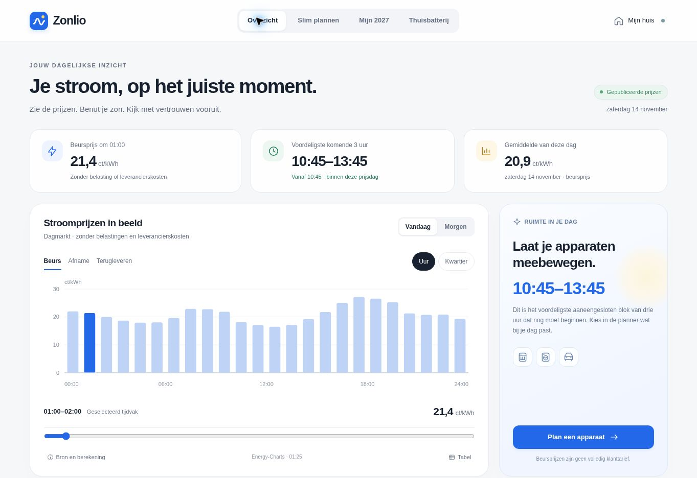
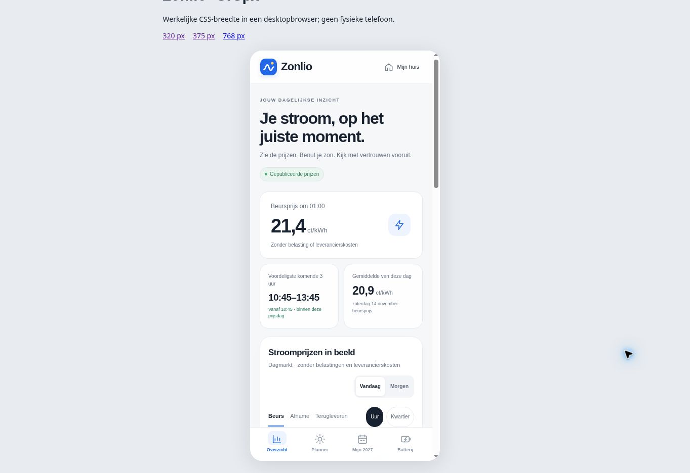

# Uitgevoerde verificatie

Datum: 14 november 2026. Deze registratie hoort bij de broncodeversie; hosting en echte mailontvangst worden afzonderlijk geverifieerd.

## Lokale controles

- `npm run check`: alle bestaande JavaScript-modules syntactisch geldig.
- `npm test`: **60 tests geslaagd**, geen fouten. De afzonderlijke MySQL-test is lokaal expliciet overgeslagen omdat hier geen MySQL-testserver is geconfigureerd. Dit omvat rekenmodellen, winter-/zomertijd, data-adapters, frontenddatacontracten, serverroutes, authenticatie, opslag en gesimuleerde mailuitval.
- `npm run build`: geslaagd; uitsluitend publieke bestanden komen in `dist`.
- `npm audit --omit=dev --audit-level=high`: geen kwetsbaarheden gevonden op het moment van deze controle.

## GitHub Actions en echte MySQL

[Run 43533879604](https://github.com/Michaelwmdegroot/zonlio/actions/runs/43533879604) voor commit `1eaf954b486e6a72d13441214f207e5b4be135d2` is **geslaagd**. Installatie, syntaxchecks, de volledige testsuite, productiebouw en dependency-audit zijn groen.

De workflow heeft een echte **MySQL 8.0**-service gestart. De afzonderlijke integratiestap is ook geslaagd: schema-aanmaak met InnoDB, twaalf gelijktijdige idempotente aanvragen, status/historie/statistieken en transactionele rollback bij een outboxfout. De test draait op een expliciete, lege testdatabase en verzendt geen e-mail. Dit bewijst de driver- en SQL-integratie; de daadwerkelijke Hostinger-productiedatabase moet nog worden aangesloten.

## Betekenisvolle fout- en integratieproeven

- Eén aanvraag bij twaalf gelijktijdige herhalingen met dezelfde aanvraagcode.
- Aanvraag en wachtrij blijven bestaan na opnieuw openen van de database.
- Een fout bij het opslaan van de outbox rolt ook de aanvraag terug.
- Een SMTP-storing laat de aanvraag behouden; herstel verzendt via een testtransport.
- Geen productie-uitwijk naar SQLite wanneer MySQL ontbreekt.
- Een directe start zonder omgevingsinstellingen gebruikt productiegedrag en maakt geen lokale leadopslag.
- Beheersessies, CSRF, toegestane origin, cookie-instellingen en uitloggen.
- Ontbrekende prijsdata worden geen nullen; negatieve prijzen blijven geldig.
- Nederlandse klokwisseldagen met 92 en 100 kwartieren blijven volledig.
- Statische routes kunnen geen bronserver, database, omgevingsbestand of symlink uitleveren.
- Gebruiksevenementen vereisen actieve toestemming en accepteren geen vrije contactgegevens.

## Externe data

De daadwerkelijke servicemethode leverde op 14 november 2026 een geldige Nederlandse prijsdag met 96 kwartieren. De MET Norway-koppeling leverde een regionale verwachting met 90 tijdstappen voor Leiden. Een eerdere netwerkfout werd als niet-beschikbare data afgehandeld. Zie [DATA-SOURCES.md](DATA-SOURCES.md) voor de beperkte reikwijdte van deze proef en de bronnen.

## Browsercontrole

De beheerde preview werd later beschikbaar en is met de gebouwde applicatie gecontroleerd. De tijdelijke omgeving gebruikte een afzonderlijke lokale QA-database, zonder SMTP-configuratie. De testgegevens en QA-configuratie zijn na afloop verwijderd.

- Desktopweergave: echte gepubliceerde prijzen, 24 uurwaarden en 96 kwartieren; prijsselectie en planner reageren.
- Morgen: de interface toont **Nog niet gepubliceerd** en geeft geen fictieve planning.
- 2027: de schuif van 50% naar 51% verandert het scenario van €560 naar €550; terugzetten herstelt het uitgangspunt.
- Advies: kanaalkeuze wijzigt het verplichte veld en de exacte contacttekst. Een testaanvraag met een ongeldig-voor-aflevering `example.invalid`-adres wordt opgeslagen en geeft een ontvangstnummer. Het rekenprofiel bleef volgens de keuze ongedeeld. Er is geen echte mail verzonden.
- Mobiele breedtes 320 en 375 pixels: Overzicht, Planner, Mijn 2027 en Batterij zijn via de ondernavigatie bereikbaar, zonder horizontale overflow. Dit is een CSS-viewportcontrole in een desktopbrowser, geen fysieke iPhone- of Android-test.
- De beheerlogin is visueel geopend. De ingelogde beheerschermen zijn in deze browserronde niet doorlopen; beveiliging en beheerhandelingen zijn via de HTTP-/database-integratietests gecontroleerd.

De screenshots tonen de werkelijke lokale interface met de opgehaalde prijsdag van 14 november 2026. Ze zijn geen bewijs dat `zonlio.nl` al deze versie serveert.

## Openstaande verificatie op de deployment

De werkelijke Hostinger-runtime, productiedatabase, DNS/HTTPS, mailboxauthenticatie, inboxontvangst en geplande onderhoudstaak zijn nog niet bevestigd. Dit zijn afzonderlijke uitrolcontroles, geen bewijs uit de tests met testgegevens.

De volledige gebruikersroute, ingelogde backoffice en echte aflevering moeten na de Hostinger-koppeling nogmaals op het uiteindelijke HTTPS-domein worden bevestigd.
